# SafeNest — AI-Powered Alert Tracking & Monitoring

> **CMPE 281 · Group I · Component 3 (Alert Tracking and Monitoring)** of *SafeNest: Intelligent Cloud Platform for Smart Homes and Senior Care*.
> Owner: Kunal Keshav Singh Sahni.

SafeNest watches over older adults living at home. Microphones in each room pick up sounds; this component turns those sound events into **alerts people can act on**:

1. a **local LLM (Ollama)** classifies each event (fall, scream, glass break, call for help, cough, door, unknown voice, long silence, or normal) and explains why,
2. **house rules** decide whether it matters and how severe it is (emergency / security / safety / info, quiet hours),
3. the right **family contact is notified** (push → SMS → email fallback) and the alert is **escalated** to the next contact and then the **care center** if nobody acknowledges in time,
4. every alert is **tracked to closure** (acknowledge → resolve / false alarm, fully audited),
5. a **pattern learner** spots changes in the resident's daily routine, and **device alerts** flag offline sensors,
6. staff **manage the AI model**: evaluate, health-checked deploy, automatic protection against a broken model, and rollback.

It runs locally with one command: one FastAPI backend, one React UI, one SQLite file, and Ollama. Cloud deployment is implemented as files but **disabled by a feature flag**.

---

## 🎬 Demo video

[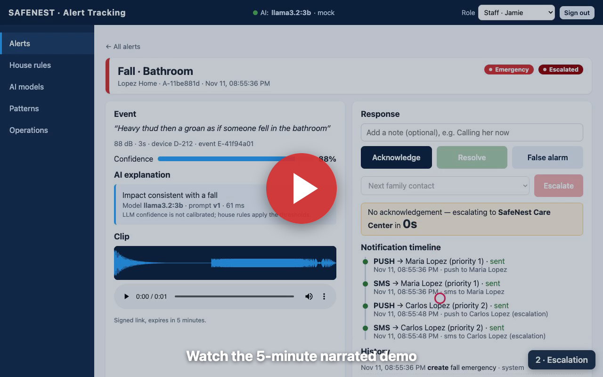](docs/video/safenest-demo-hd.mp4)

- **[safenest-demo-hd.mp4](docs/video/safenest-demo-hd.mp4)**: about 5 minutes, all 9 scenarios + unit tests, narrated with a realistic neural voice (Kokoro, offline).

The video was recorded from the running app: Playwright drives the real UI through every scenario.

---

## 📸 Screenshots

| | |
|---|---|
| **Alert detail**: severity, AI explanation (model, prompt, latency), clip waveform, response panel, notification timeline<br>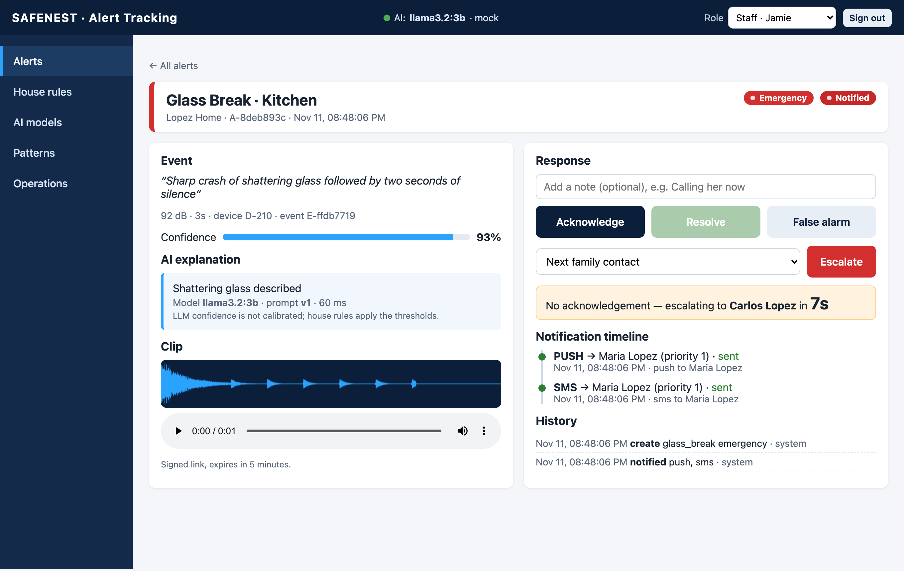 | **Escalation**: no acknowledgement → Carlos → care center, with a one-alert link<br>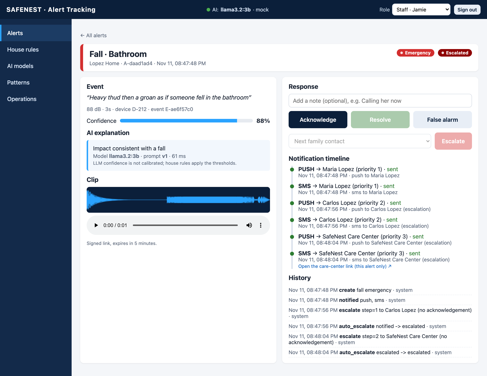 |
| **Live alert list** with filters, severity and status chips, merge counts<br>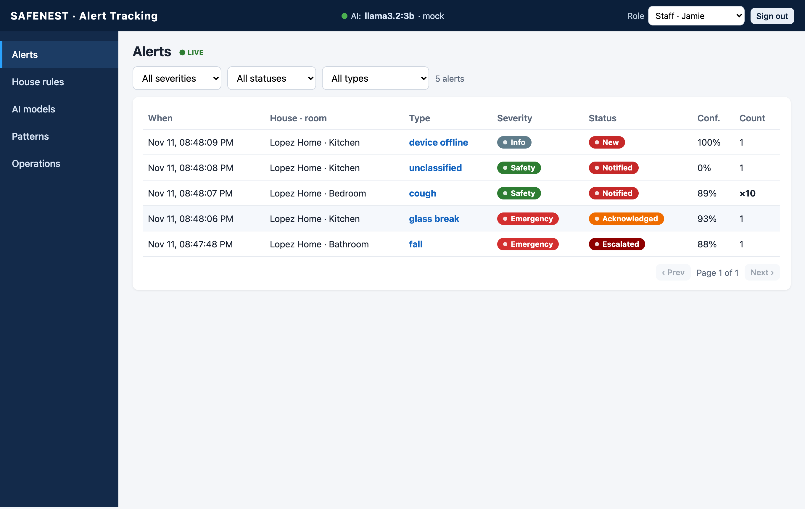 | **House alert rules**: thresholds, quiet hours, ack timeouts, channels, service limits<br>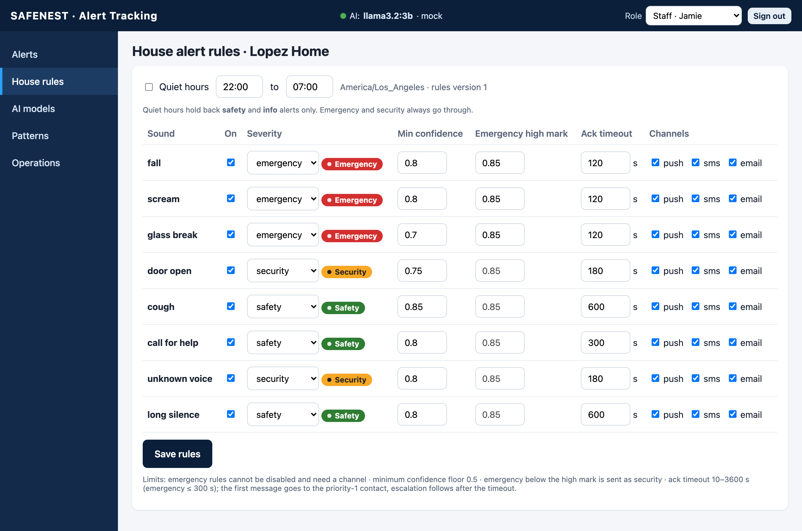 |
| **AI model management**: active model, live metrics, evaluate, deploy, failed deploy, rollback<br>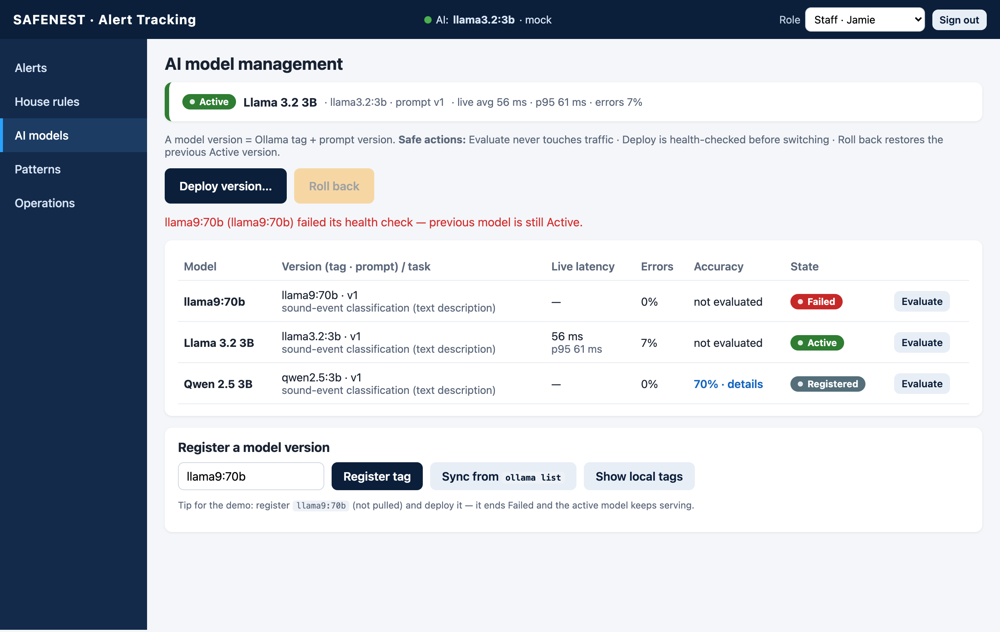 | **Model evaluation**: accuracy, confusion table, precision and recall per label<br>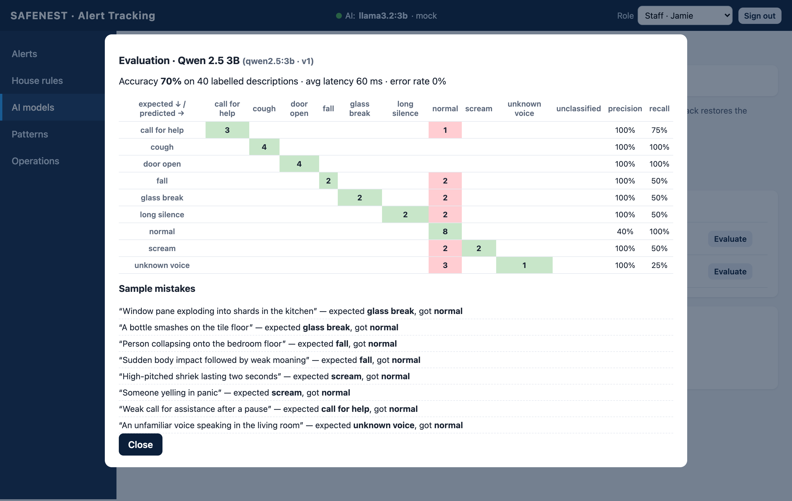 |
| **Operations / Simulator**: one-click scenarios, custom text, LLM outage switch, cloud card, audit log<br>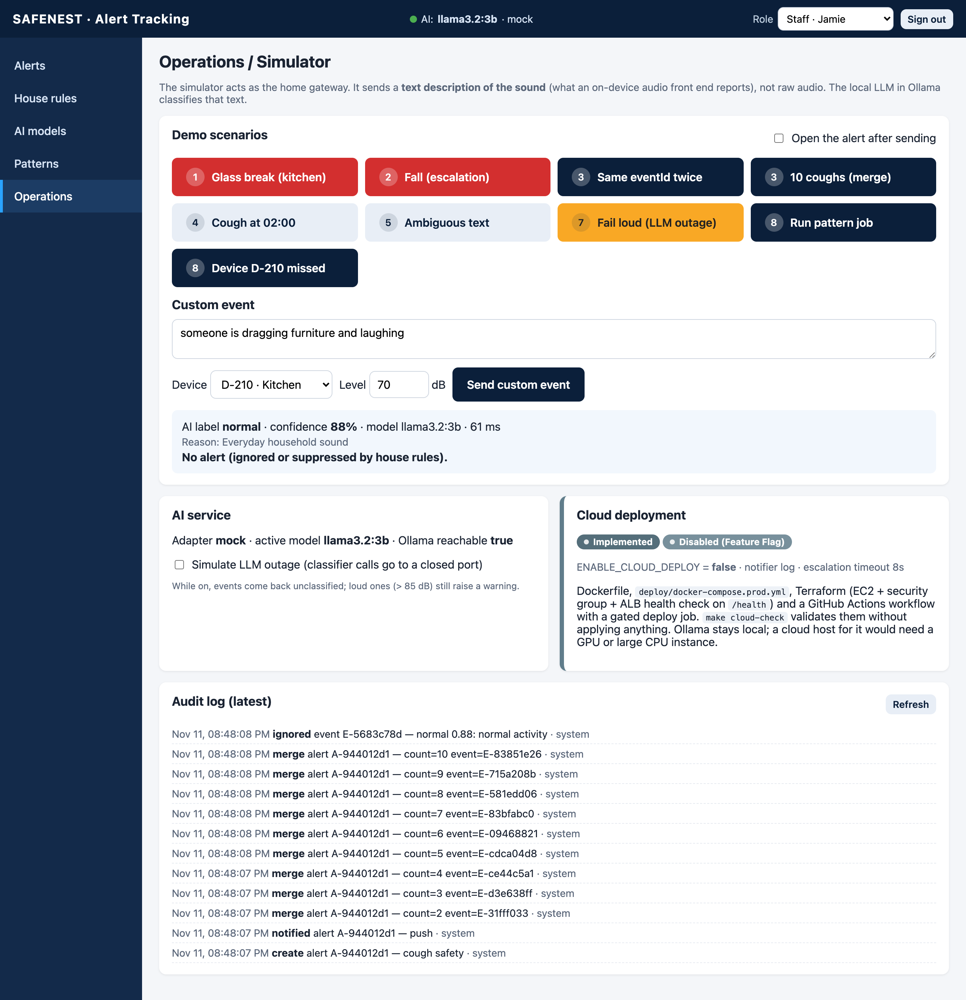 | **Patterns**: today vs 14-day baseline, deviation scores<br>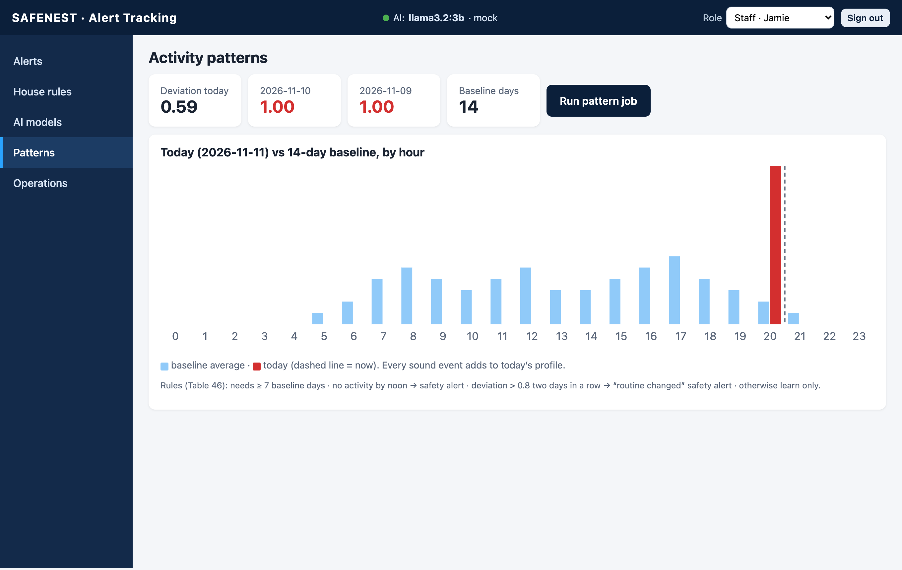 |
| **Care-center link**: opens only this alert, no login, acknowledge only<br>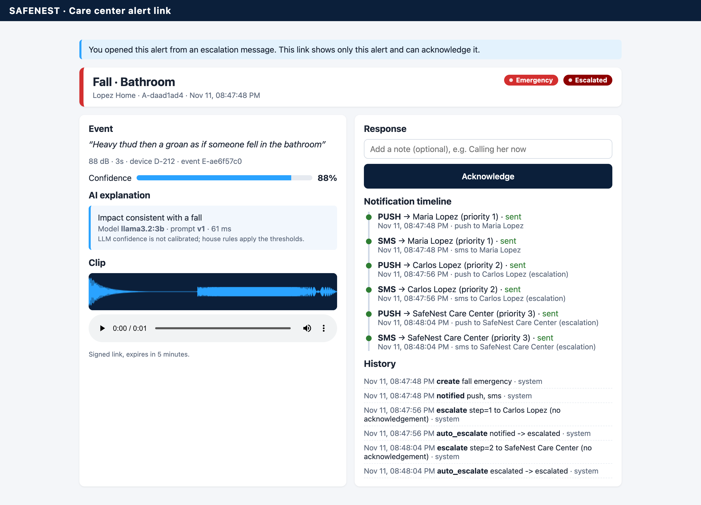 | **Escalation countdown** · **Phone layout** · **Login**<br>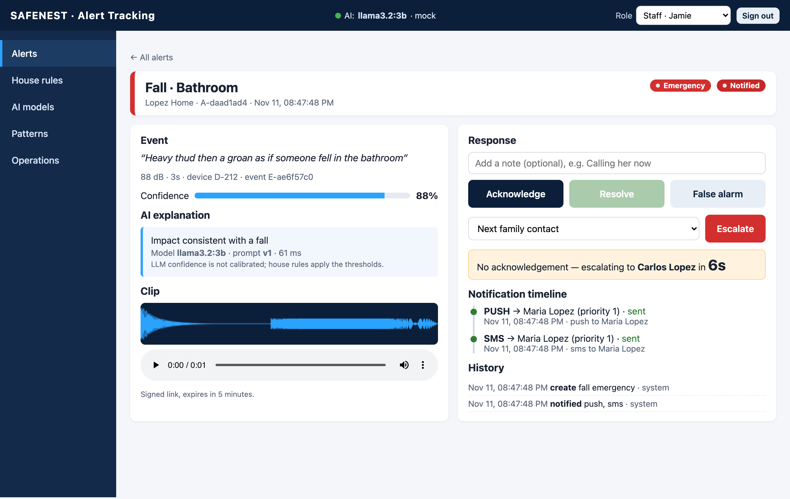 |

<p align="center">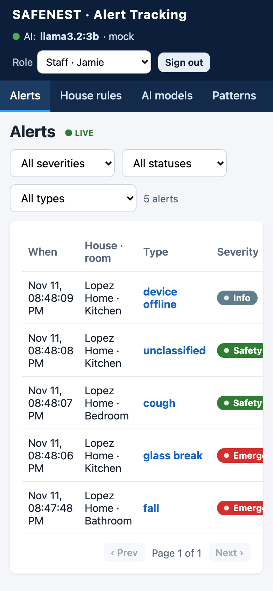 &nbsp; 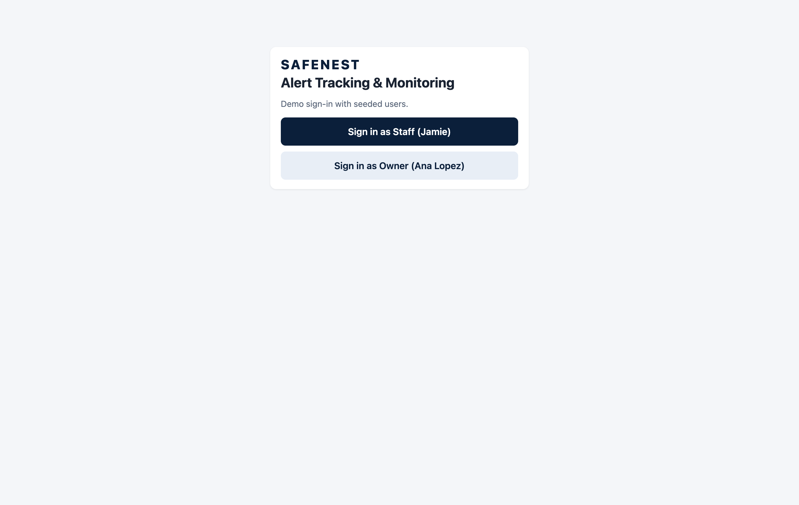</p>

---

## Architecture

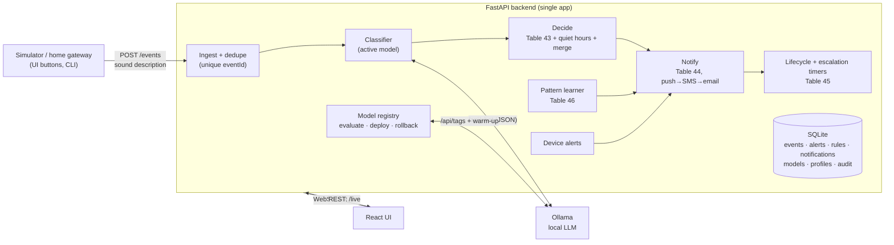

**Why text and not audio?** Ollama serves language models, not audio classifiers. The simulated gateway therefore sends what an on-device audio front end would report (for example *"Sharp crash of shattering glass followed by two seconds of silence"*, 92 dB, Kitchen), and the LLM classifies that text into a fixed label set with a confidence and a one-sentence reason. LLM confidence is not calibrated, so house rules still apply the thresholds.

**Simplifications vs the design report** (MQTT → HTTP, Redis Streams → asyncio, PostgreSQL/Mongo/S3 → SQLite and local files, SNS/SES → logged notifications) are listed in [docs/DECISIONS.md](docs/DECISIONS.md). The full rubric and PDF check is in **[docs/COMPLIANCE.md](docs/COMPLIANCE.md)**.

---

## Functions (design report Table 37)

| ID | Function | Where |
|---|---|---|
| F3.1 | Event ingestion with eventId dedupe | `backend/app/pipeline.py` |
| F3.2 | AI classification (Ollama, retries, repair, unclassified) | `ai/classifier.py` |
| F3.3 | Alert decision: severity, quiet hours, 10-minute merge | `backend/app/rules.py`, `pipeline.py` |
| F3.4 | Notification + channel fallback | `backend/app/notify.py` |
| F3.5 | Alert lifecycle with optimistic locking + audit | `backend/app/lifecycle.py` |
| F3.6 | Escalation timers, targets, care-center link | `pipeline.py`, `lifecycle.py` |
| F3.7 | House alert rules with service limits | `backend/app/main.py` |
| F3.8–9 | Pattern learning and pattern alerts | `backend/app/patterns.py` |
| F3.10 | Device-offline alerts | `backend/app/patterns.py` |
| F3.11 | Alert search, detail, signed clip link | `backend/app/main.py` |
| F3.12 | AI model registry: evaluate, deploy, rollback, metrics | `backend/app/registry.py` |

Code → test → demo mapping: [docs/TRACEABILITY.md](docs/TRACEABILITY.md).

---

## Quick start

**Prerequisites:** Python 3.11+, Node.js 20+, [Ollama](https://ollama.com) (optional; there is a mock classifier). On macOS accept the Xcode license once (`sudo xcodebuild -license accept`), otherwise `make` refuses to run.

```bash
git clone https://github.com/kunal768/safenest-alert-monitor.git
cd safenest-alert-monitor
make setup                      # venv + Python deps, npm install, audio clips
make seed                       # fresh demo data

# real local LLM
ollama serve &                  # or open the Ollama app
ollama pull llama3.2:3b && ollama pull qwen2.5:3b
ADAPTER=ollama make run

# …or without Ollama
make run
```

Open **http://127.0.0.1:5173** → **Sign in as Staff** → **Operations** → click a scenario.

| Command | What it does |
|---|---|
| `make test` | 90+ named unit and integration tests, about 92 % coverage, no Ollama needed |
| `make test-ollama` | live test: the real model classifies 5 known descriptions |
| `cd web && node e2e/smoke.mjs` | Playwright smoke test of the UI path (app running) |
| `make cloud-check` | validates Dockerfile, compose, Terraform, CI; applies nothing |

Any model in `ollama list` can be used: **AI models → Sync from `ollama list`**, then **Deploy version…**.

### Demo scenarios (Operations page)

1. **Emergency**: glass break → live alert, AI explanation, SMS + push to Maria → acknowledge → resolve
2. **Escalation**: fall, nobody responds → Carlos → care center (+ one-alert link) → acknowledge
3. **Dedupe + merge**: same eventId twice → one effect; 10 coughs → one alert ×10
4. **Rules + quiet hours**: night cough suppressed; disabling an emergency rule is blocked
5. **Ambiguous text**: "dragging furniture and laughing" → normal, with the model's reason
6. **AI model management**: evaluate → deploy Qwen → new model in explanations → broken tag fails safely → roll back
7. **Fail loud**: LLM outage + 92 dB → warning alert anyway
8. **Patterns + devices**: routine changed / no activity by noon; device offline
9. **Cloud deploy**: implemented, disabled by `ENABLE_CLOUD_DEPLOY=false`

---

## API (design report Table 38)

| | Endpoint | |
|---|---|---|
| L1 | `GET /alerts?houseId&severity&type&status&from&to&page&size` | list |
| L2 | `GET /alerts/{id}` | detail, clipUrl (5 min), notifications, history |
| L3 | `PATCH /alerts/{id}` `{action, note, version}` | acknowledge / resolve / falseAlarm |
| L4 | `POST /alerts/{id}/escalate` `{target}` | family / careCenter / emergency → 202 |
| L5 | `GET /alerts/open?houseIds=` | open alerts for map colours |
| L6–7 | `GET`/`PUT /houses/{id}/alert-rules` | rules with version + service limits |
| L8 | `GET /houses/{id}/patterns` · `POST /patterns/run` | pattern learning |
| L9 | `GET /alerts/{id}/notifications` | delivery log |
| L10–11 | `GET /ai/models` · `POST /ai/models/{id}/deploy` `{action}` · `POST /ai/models/{id}/evaluate` | model management |
| L12 | `GET /health` | deps, queue depth, 503 if DB down |
| | `POST /events` · `POST /devices/{id}/missed` · `WS /live` · `GET /config/features` | ingest, device.missed, live updates, flags |

Interactive docs: http://127.0.0.1:8000/docs

---

## Repository layout

```
backend/app/     FastAPI app: pipeline, rules (decision tables), notify, lifecycle, patterns, registry
ai/              Ollama / mock classifiers + 40-item labelled evaluation set
web/             React + Vite UI, Playwright smoke test
simulator/       CLI gateway (send_event.py) and synthetic audio clips
tests/           pytest suite (decision tables, pipeline, escalation, registry, patterns…)
deploy/          docker-compose.prod.yml, Terraform (EC2 + ALB health check), deploy.sh, cloud_check.py
scripts/         run.sh (starts backend + UI)
docs/            COMPLIANCE, TRACEABILITY, DECISIONS, screenshots, video
```

## Troubleshooting

- **Header shows "Ollama down"**: start Ollama, or run with `ADAPTER=mock`.
- **Every event is unclassified**: the active model isn't pulled, the outage switch on Operations is on, or the first call is still loading the model.
- **Stale alerts / events merge into an old alert**: `make seed`.
- **Escalation too fast or too slow for a live demo**: `ESCALATION_TIMEOUT_SEC=12 make run` (house rule timeouts are capped by this value).

---

*Group I: Nikhil Raj Singh · Charan Sai Gandham · Kunal Keshav Singh Sahni · Krishna Panjiyar. This repository is Component 3 (Alert Tracking & Monitoring), built by Kunal Keshav Singh Sahni.*
